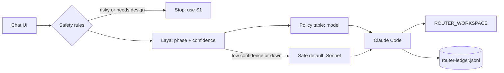

# Harness Router

A chat interface above the agent harnesses. Laya classifies each new request, a policy table picks the harness and model, and the conversation stays on that route.



## Status: spike

| Works | Not there yet |
|---|---|
| Routing between Opus, Sonnet and Haiku through Claude Code | Copilot CLI and the own-loop harness |
| Safety stop, `/route` override, pinned conversations | Conversations surviving a restart |
| Tool approval, resumed follow-ups | Pinned or offline Laya model |
| Metadata-only ledger | Sandbox |

**There is no sandbox.** The agent runs as you, with your files and network, in the workspace you point it at. Use a repo you trust, and approve tools with care. Claude Code's own settings on your machine still apply, so some tools may run without asking.

The browser UI has only been checked to load. The chat flow was tested through the API, and on a personal login rather than Vertex, so expect some rough edges on first use.

## 1. Prerequisites

- .NET 9 SDK
- Python 3.10 or newer
- Claude Code CLI (`claude --version`)
- About 4 GB of free disk for Laya, its dependencies and its model
- Network access to PyPI and Hugging Face for the first run

## 2. Log in

```bash
gcloud auth application-default login
```

Point Claude Code at Vertex in the terminal where you will start the app (step 5), using your own project and region:

```bash
export CLAUDE_CODE_USE_VERTEX=1
export ANTHROPIC_VERTEX_PROJECT_ID=<your-project>
export CLOUD_ML_REGION=<your-region>
```

Check that it works before going further:

```bash
claude -p "say hello" --model sonnet
```

If this fails, the app will fail too. Your project also needs access to the Opus, Sonnet and Haiku models, because the policy table uses all three.

## 3. Install Laya

```bash
python3 -m venv .venv
.venv/bin/pip install laya==0.4.20
```

## 4. Start Laya (terminal 1)

```bash
.venv/bin/python laya-service/server.py
```

The first run downloads the model. Wait for `laya ready on 127.0.0.1:8099`.

## 5. Start the app (terminal 2)

Run the exports from step 2 in this terminal, then:

```bash
ROUTER_WORKSPACE=/path/to/your/repo dotnet run --project src/HarnessRouter
```

Open http://localhost:5180.

## 6. Check it works

| Send this in a new conversation | Expect |
|---|---|
| `Fix the crash when the divide function gets zero` | A line like `claude-code · sonnet · phase debug (0.85)` |
| `Compare two options for structuring this code and give me a plan` | `claude-code · opus · phase plan` |
| `Migrate the production database to Postgres` | A stop message pointing to S1, and no agent started |

The first two start a real agent in your workspace, so point it at a repo you don't mind it reading.

If the route line says `laya unavailable`, the Laya service isn't running. The app still works on the safe default.

## Using it

- **New** starts a new conversation. Laya routes only the first message, and follow-ups stay on the same route.
- **Approve and continue** appears when Claude Code is denied a tool. It allows that tool for the rest of the conversation.
- **Override a route or a stop** by starting a new conversation with `/route opus ...`, `/route sonnet ...` or `/route haiku ...`.

## Settings

| Variable | Default | Purpose |
|---|---|---|
| `ROUTER_WORKSPACE` | Current folder | Repo the agent works in |
| `ROUTER_PORT` | `5180` | App port, on localhost only |
| `ROUTER_LEDGER` | `./router-ledger.jsonl` | Where the ledger is written |
| `ROUTER_LAYA_URL` | `http://127.0.0.1:8099/` | Laya service |
| `ROUTER_CLAUDE` | `claude` | Claude Code command |

The ledger records routes, approvals, status and cost, never prompts or output. Cost figures appear to be cumulative across a conversation, so don't add them up.

## Changing the routing

- **Which model each phase uses:** `Policy` in `src/HarnessRouter/Routing.cs`
- **What gets stopped:** `SafetyRules` in the same file. It's a short keyword list, so it will miss some risky requests.
- **Confidence threshold:** `minConfidence` on `Router`, default 0.7

## Test

```bash
dotnet test
```

The tests use a fake CLI, so they need no login, no Laya and no model calls.
